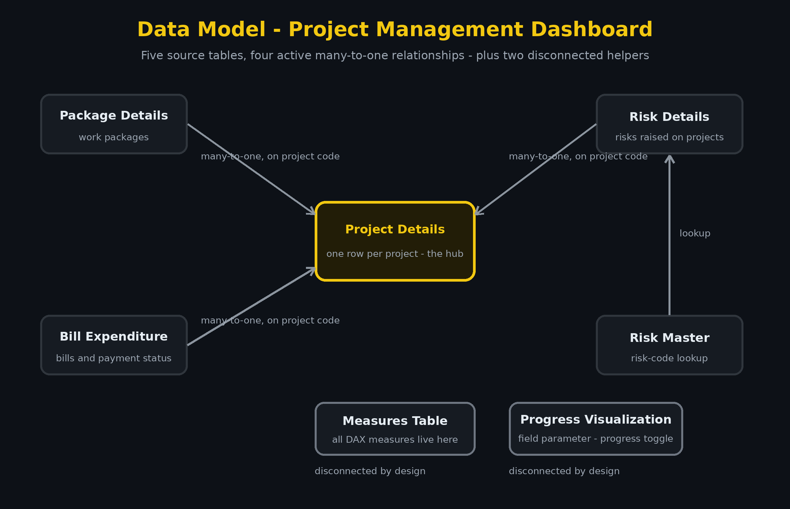
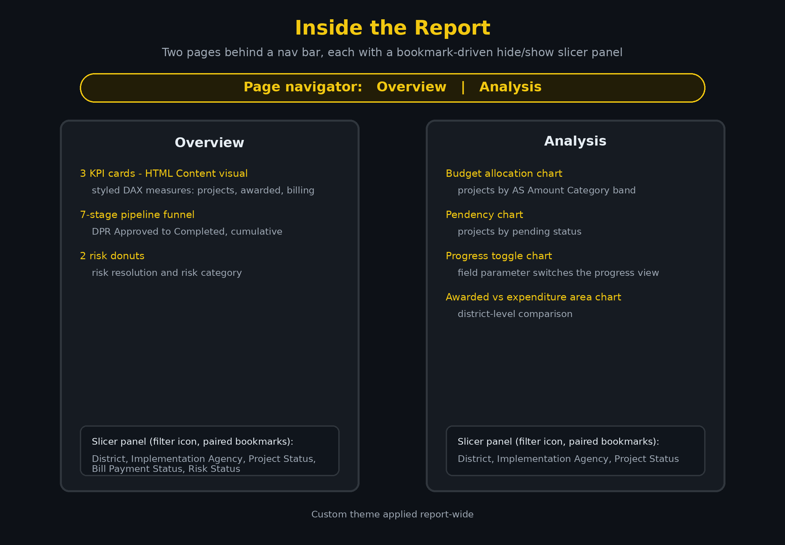

# Project Management Dashboard (Power BI)

An interactive Power BI dashboard that monitors a portfolio of 1,800+ infrastructure projects and their work packages through the approval pipeline (DPR, administrative sanction, technical sanction, tender, award, execution, completion), tracking progress, budgets, expenditure, pendency and risk in one report.

Built from business reporting requirements, it gives stakeholders a single view of where every project stands. The `.pbix` file is included in this repository with the data embedded, so it opens directly in Power BI Desktop with no extra setup.

**Just want to see it? Download [Project_Management_Dashboard.pbix](Project_Management_Dashboard.pbix) and open it in Power BI Desktop** - the data travels with the file.

## Data model

Five source tables, related through 4 active many-to-one, single-direction relationships:

| Table | Role |
| --- | --- |
| Project Details | one row per project - the hub |
| Package Details | work packages, linked to Project Details on the project code |
| Bill Expenditure | bills and their payment status, linked to Project Details |
| Risk Details | risks raised on projects, linked to Project Details |
| Risk Master | risk-code lookup off Risk Details |

Measures live in a disconnected Measures Table, and a field parameter (Progress Visualization) drives the progress toggle on the Analysis page - both disconnected by design.

## Report

Two pages behind a nav bar, with a bookmark-driven hide/show slicer panel on each - District, Implementation Agency and Project Status on both pages, plus Bill Payment Status and Risk Status on the Overview page:

- **Overview:** three KPI cards rendered with the HTML Content custom visual (styled DAX measures), risk-resolution and risk-category donuts, and the 7-stage cumulative pipeline funnel from DPR Approved to Completed.
- **Analysis:** budget-allocation and pendency column charts, a progress-toggle chart driven by the Progress Visualization field parameter, and a district-level awarded-vs-expenditure area chart.

Custom theme applied report-wide.

## Inside the report

## Tools and tech

- Power BI Desktop
- Power Query for data integration and transformation
- DAX measures and calculated columns for the project and financial KPIs
- HTML Content custom visual for the KPI cards

## Repository contents

| Path | Purpose |
| --- | --- |
| `Project_Management_Dashboard.pbix` | The complete report file with embedded data - opens directly in Power BI Desktop |
| `docs/data-model-diagram.png` | Data model diagram: tables, relationships and the disconnected helpers |
| `docs/report-structure.png` | Map of the report's two pages, their visuals and slicer panels |
| `README.md` | This file |

## Techniques worth noting

- **HTML-content KPI cards:** the three KPI cards are DAX measures returning styled HTML, rendered through the HTML Content custom visual - full control over layout, badges and colours.
- **7-stage cumulative funnel:** one funnel visual counts the projects that reached each pipeline stage, from DPR Approved through Awarded and Started to Completed.
- **Banded categories:** budget bands, financial-progress bands and pendency status are calculated columns on Project Details, so the Analysis charts group projects into readable buckets.
- **Bookmark slicer panel:** a filter icon toggles a slicer panel via paired bookmarks per page, keeping the canvas clean.
- **Field-parameter toggle:** the Progress Visualization parameter switches the Analysis chart between progress views without duplicating visuals.

## How to run

1. Install [Power BI Desktop](https://powerbi.microsoft.com/desktop/) (free).
2. Download `Project_Management_Dashboard.pbix` from this repo.
3. Open the file - the data is embedded, so the full report loads without any extra setup.

## Notes

- All data is embedded in the `.pbix` file; no external data source or gateway is needed to explore the report.
- Data was integrated and transformed from multiple sources with Power Query, and the design follows dashboard best practices so complex project data reads clearly for business stakeholders.
